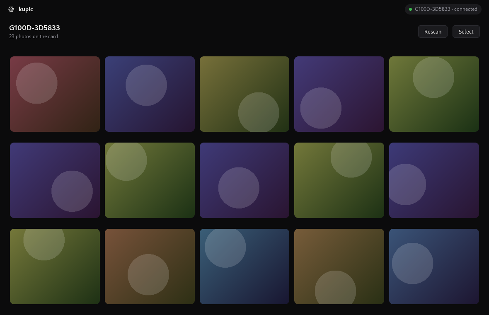

# kupic

Pulls photos off a camera that brings its own Wi-Fi, straight to your
computer or phone, without the maker's app. Native UI, no browser, no account.

Any camera that serves its card over its own Wi-Fi belongs here. kupic is
written and tested against a **Panasonic Lumix G100D** today; see
[Which cameras](#which-cameras).



## Which cameras

kupic talks to a camera the way mirrorless cameras expect to be talked to: the
camera starts its own Wi-Fi network or joins yours, and serves its card over
UPnP. That shape is common. The protocol on top of it is not: every maker
speaks its own, and the maker's app is usually the only client.

| | Today |
|---|---|
| Works, tested | Panasonic Lumix G100D |
| Should work | Other Lumix bodies over the same `cam.cgi` interface |
| Not yet | Canon, Sony, Nikon, Fujifilm, Olympus. Each needs its own session and listing code. |

Nothing in kupic pretends otherwise: it looks for Lumix cameras, and its Wi-Fi
protocol is Panasonic's. Supporting another maker means adding that maker's
protocol behind the same interface, which is one package, not a rewrite. The
app does not claim a camera it has not been run against.

## Why

It started with a Lumix G100D. Panasonic's own tools are Windows-only, and
LUMIX Sync on a phone is slow and unreliable: the Bluetooth pairing drops,
connecting is fiddly, and choosing what to send is worse than a file dialog.
kupic does the one job that matters, get the photos off the card, with a grid
you can actually use.

The same complaint applies to most camera apps, which is why the shape of
kupic is not Lumix-shaped: a card is a card.

## What it does

- **Reads the card over USB.** Plug the camera in and turn it on; with
  `[USB Mode]` set to `[PC(Storage)]` it shows its SD card as a drive, and
  kupic reads the `DCIM` folder off it. No Bluetooth, no Wi-Fi, no session,
  and a card in a USB reader works the same way.
- **Or reaches the camera over Wi-Fi.** Press *Connect over Wi-Fi* and kupic
  joins the camera's own network through NetworkManager, then lists the card.
  A camera in [Via Network] mode is found on your own network instead.
- **Or pairs it over Bluetooth.** Press *Find cameras* and kupic scans, lists
  the cameras it finds, and pairs the one you pick, registering itself on the
  camera the way the maker's app does.
- **Shows the card as a grid.** Thumbnails, multi-select, keyboard navigation.
- **Imports what you choose.** Copy the camera's own JPEG as-is, or convert to
  **PNG** or **WebP** with `ffmpeg`, at a quality you set. The RAW (`.RW2`)
  file can come along untouched.

### Choosing photos

Both shells choose several photos, each in the way that platform expects.

| | Desktop | Phone |
|---|---|---|
| Choose one | Click | Tap *Select*, then tap |
| Add or remove | Cmd-click (Ctrl-click on Linux and Windows) | Tap it again |
| A run of photos | Shift-click | Tap each |
| Choose all | Cmd+A | |
| Finish | *Done*, or press Escape | *Done* |

In selection mode a tap or click adds a photo or takes it out, which is the
only way to choose several on a phone, where there is no Cmd or Shift.

### Where imports go

The folder is the platform's own pictures directory with `kupic` inside it:
`XDG_PICTURES_DIR` on Linux, `~/Pictures` on macOS, and the app's storage on
Android. kupic creates it on first run, so an import always has somewhere to
write, and *Choose…* in the import dialog moves it anywhere else. The choice
is remembered between runs.

## Run

You need Go 1.27+ and `ffmpeg` on `PATH`.

```sh
export PATH="$HOME/.local/go/bin:$PATH"
go tool mygo dev        # run with live reload
go tool mygo build      # package into build/
just snapshots          # render the app's screens to PNG, to look at them
```

Then either plug the camera in and press **Read over USB**, or reach it over
Wi-Fi or Bluetooth.

**Over USB.** Connect the camera with its cable and turn it on. Set **MENU/SET
→ Setup → USB Mode** to **`[PC(Storage)]`** (if the camera shows a USB
selection screen, choose it there instead). kupic reads the card off the drive
the camera appears as. A card in a USB reader works the same way.

**Over Wi-Fi.** On the camera open **MENU/SET → Setup → Wi-Fi → Wi-Fi
Function → New Connection → Remote Shooting & View**. It shows an SSID and a
password; enter the password in kupic's **Wi-Fi password** field and press
**Connect over Wi-Fi**.

**Over Bluetooth.** Set the camera to pairing standby: **MENU/SET → Setup →
IN/OUT → Bluetooth → Bluetooth → SET → Pairing**. Press **Find cameras** and
pair it from the list. kupic remembers it by name, because the camera's
Bluetooth address rotates every few minutes.

To check the Bluetooth path on its own:

```sh
./build/linux-amd64/kupic probe
```

## How it talks to the camera

What follows is the Lumix implementation, which is what kupic ships. Another
maker's camera would bring its own version of the middle two sections; the
USB read and the import are the same for any camera.

The protocols are undocumented. kupic follows the reverse-engineering in
`cleverfox/lumixproto`, `njfdev/liblumix` and `palmdalian/python_lumix_control`
for Wi-Fi, and `tobiasbrummer/lux-lat-long-log` for Bluetooth. The decoded
reference lives in [docs/lumix-sync-protocol.md](docs/lumix-sync-protocol.md).

**USB (to read the card).** With `[USB Mode]` set to `[PC(Storage)]` the camera
is a plain USB mass storage device: the SD card mounts as a drive, and kupic
walks its `DCIM` folder. There is no protocol here, the photos are files.

**Bluetooth (to register and wake the camera).** A Lumix needs no BLE pairing,
its writes are plaintext, and the pairing is application-layer. kupic
subscribes to the camera's ready notifications, writes the `MEI0` session
packet and its own name, waits for both notifications, then sets the camera's
clock. Shortening that sequence makes the camera hang up. The camera
advertises a **resolvable private address** that rotates, so kupic matches it
by name, never by address.

**Wi-Fi (to transfer).** In `[Direct]` mode the camera starts its own network,
and kupic joins it through NetworkManager before looking for the camera at
`192.168.54.1`. In `[Via Network]` mode the camera joins your network instead,
and kupic finds it there directly. Current firmware always puts a password on
the camera's own network, and shows it on the camera's screen.

1. **Discover**: SSDP `M-SEARCH` for the ContentDirectory service; the camera
   answers with the URL of its device description.
2. **Connect**: read the description for the camera's UDN, then
   `GET /cam.cgi?mode=accctrl&type=req_acc&value=<udn>&value2=kupic`, and
   confirm with `mode=setsetting&type=device_name`.
3. **List**: UPnP SOAP `Browse` on `/Server0/CDS_Control`, in pages.
4. **Download**: plain `GET` of the file URLs the listing gives, which the
   camera serves on port 50001.

## Layout

```
main.go          the window, and the `probe` subcommand
app.go           the app state, its phases, and the work lifecycle
discover.go      finding a camera: Bluetooth scan, pairing, waking, SSDP
connect.go       reading a card, and joining the camera's own network
read.go          the USB read, and the diagnostics it writes
import.go        downloading and converting the chosen photos
import_dialog.go the import dialog, as state plus a builder
thumbs.go        the thumbnail cache, its workers, and decoding
view.go          the desktop shell: title bar, toolbar, action bar
view_mobile.go   the compact shell a phone or a narrow window gets
body.go          the body region both shells show
components.go    stateless builders both shells use
photos.go        the photo grid
settings.go      what the app remembers between runs
theme.go         the Leica palette and theme
icons.go         the SVGs

internal/card/     the SD card as a mounted drive, over USB
internal/camera/   the Lumix protocol: SSDP, cam.cgi, UPnP content directory
internal/ble/      BlueZ over D-Bus, and the Lumix BLE handshake
internal/wifi/     joining the camera's own access point, through NetworkManager
internal/convert/  ffmpeg wrappers
```

The root is the app: the window, its views and its features, one file per
feature. Everything it is built on lives under `internal/`, so no other module
can import it.

## Desktop and phone

One Go binary builds for both. `app.compact`, set from the window's size in
`view`, switches the shell: a desktop window gets a title bar and a toolbar,
while a phone, or a narrow window, gets the actions along the bottom where a
thumb reaches and no title bar to drag.

The hardware paths are still desktop-only. `/proc/mounts`, `nmcli` and BlueZ
do not exist on a phone, so a phone build opens, lays out and themes correctly
but finds no camera yet.

## Not yet

- **Cameras that are not Lumix.** The protocol layer is one package, so another
  maker's camera is that package's second implementation, not a rewrite. It is
  not written yet, and kupic does not claim to read a camera it has not been
  run against.
- **Finding a camera on a phone.** The Wi-Fi path would work there, given a
  platform network API in place of `nmcli`.
- Deleting from the camera.
- Browsing folders on the card, or filtering by date.
- **Returning to your own network** after a `[Direct]` import, if you switch
  networks from somewhere other than kupic's *Back online*.

## Building a package

```sh
# this machine
just build

# Android: needs the SDK, the NDK and a JDK 17
export ANDROID_HOME=$HOME/Android/Sdk
export ANDROID_NDK_HOME=$ANDROID_HOME/ndk/30.0.16248370
export JAVA_HOME=/path/to/jdk-17
go tool mygo build -platform android
```

MyGo v0.10.0 or later is needed for the Android target; `go.mod` pins the
version and points at a local checkout of it.

## License

MIT. See [LICENSE](LICENSE).

## Credits

- [MyGo](https://mygo.egoist.dev/) by [EGOIST](https://github.com/egoist),
  which draws the window.
- The Lumix protocol reverse-engineering projects listed above, including
  [lux-lat-long-log](https://github.com/tobiasbrummer/lux-lat-long-log) for
  the Bluetooth handshake.
